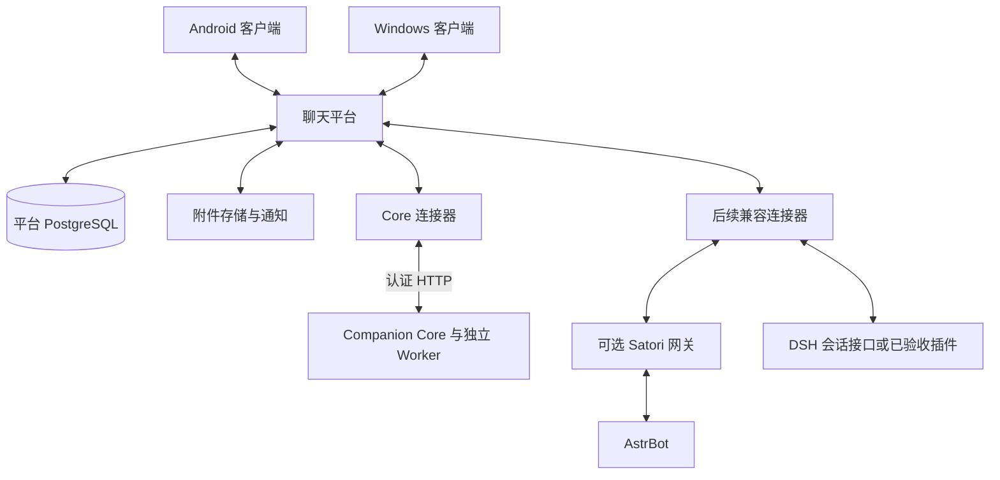

# 通用聊天平台方案

日期：2026-11-10。状态：总体产品路线；当前实现切片为一轮 Core 性能修复及 Windows 原生文本聊天。已确认合同与运行方式见 [原生文本 MVP](../native-chat-mvp.md)。后续的独立多账号平台、流式、Android 和 Bot 连接器尚未实现。

建设一个独立运行的通用机器人聊天平台，提供 Android、Windows 客户端、统一账号、会话、消息记录、同步和通知。首先完整接通 Companion Core，形成可日常使用的流式聊天体验；随后接入 AstrBot、DeepSeek Harness（DSH），让用户继续使用自己的机器人框架、人格、记忆和插件。

平台承担聊天基础设施；Core 是首个正式支持的后端。原生聊天的登录、输入、回复、历史、主动消息和通知应在没有 QQ 账号、QQ 协议端或 AstrBot 运行时的环境中完成。

## 1 产品目标与交付范围

### 后续双端日常版本

- Android、Windows 使用同一账号登录，能够查看同一会话、发送消息、查看历史和收到主动消息。
- 文本流式回复，支持自然语义气泡和长文本连续显示；状态明确区分处理中、完成、中断、失败和结果不确定。
- 客户端离线后补齐历史；发送重试、重复事件、多设备在线不重复触发同一轮回复。
- Core 继续拥有自己的记忆、人格、日记、来源证据、授权、预算和遗忘机制。
- 具备设备撤销、机器人绑定、会话权限、消息删除和可追踪的后端处理状态。
- 首期交付以 Core 为验收对象；机器人登记、会话绑定和能力展示从一开始容纳其他后端。

首个技术切片只需贯通一个客户端和 Core。日常可用版本再补齐双端、后台通知、故障恢复与必要的多媒体能力。图片、文件可在文本闭环后分项交付；语音输入、语音合成和实时音视频另行扩展。

### 后续兼容目标

AstrBot 和 DSH 的用户可以绑定已有实例，通过同一套客户端聊天。每种后端独立验收文本、流式、附件、主动消息、取消、恢复和删除能力。人格、插件状态与长期记忆继续由对应后端管理；已有平台身份和历史的继承按明确映射或导入合同处理。

多人群聊、公开机器人目录、插件分发市场、复杂组织权限和联邦互通属于后续产品范围。首期面向受控账号和用户自己的机器人，先把一对一聊天做稳定。

## 2 架构与职责

| 模块 | 拥有的职责与数据 |
|---|---|
| 客户端 | 输入、展示、本地缓存、待发送队列、设备凭据、同步游标和通知设置 |
| 聊天平台 | 账号与设备、机器人访问权、逻辑会话、用户可见消息、后端交接记录、同步、附件归属、通知 |
| 后端连接器 | 后端身份与会话映射、协议转换、能力投影、任务关联、输出归一化和恢复查询 |
| Core | 自己的回复决策、上下文、记忆、人格、日记、工具准入、来源证据、预算和遗忘回放 |
| AstrBot 或 DSH | 各自 Agent、插件、模型调用、内部上下文和运行状态 |
| 模型适配器 | 供应商协议、流式解析与标准化结果；由调用方处理授权、账务、存储和投递 |

平台可采用模块化单体部署，Core、后端连接器的独立 Worker 按执行与恢复需求拆进程。同一仓库和同一主机可以承载首期部署，但平台通过正式接口调用后端；数据库由各自模块拥有，客户端不访问后端内部表。

同一条消息只能选择一个主要回复后端。会话绑定后端实例；一轮开始时固定原绑定及配置版本，后续更改不重定向已经接受的任务。Core 调用 DSH 执行任务时，DSH 结果返回 Core 的工具链；用户直接与 DSH 聊天时，平台路由到 DSH 会话。这两种职责分别使用对应合同。

## 3 技术路线与复用决策

| 位置 | 建议路线 | 选择依据 |
|---|---|---|
| 平台后端 | Python、FastAPI、模块化单体和独立派发 Worker | 复用现有工程经验、类型校验和 HTTP 生态；后端接入与请求处理分开 |
| 客户端 | Windows 最小版使用 Tk；双端阶段再验证 Flutter 共用实现 | 共享主要界面与同步逻辑；通知、凭据存储和后台行为按平台验证 |
| 原生接口 | HTTPS 请求配合 SSE 事件订阅 | 发送、查询与控制走普通请求，服务器输出通过事件流下发 |
| 平台存储 | PostgreSQL；客户端 SQLite；附件独立存储 | 平台从一开始有账号、会话归属和持久恢复；客户端离线数据有独立生命周期 |
| Core 接入 | 受控 HTTP 接口、持久任务与结果订阅 | 延续 Core 事务、幂等和独立 Worker；聊天平台不导入 Core 的内部存储 |
| 框架兼容 | 后续评估 Satori、AstrBot HTTP、DSH 原生会话接口 | 用实测能力和维护成本选择每个后端的正式入口 |

SSE 提供服务器向客户端的事件通道；事件的持久化、重放和权限仍由平台实现。[SSE 说明](https://developer.mozilla.org/en-US/docs/Web/API/Server-sent_events/Using_server-sent_events)。Flutter 提供原生 Windows 构建和桌面插件扩展基础，但跨平台框架本身不证明后台通知已经可用。[Flutter 官方说明](https://docs.flutter.dev/platform-integration/desktop)

聊天底座有两条成熟方向需要在第一个实现切片前作最终比较：

| 方向 | 可复用部分 | 主要代价 |
|---|---|---|
| 复用 Matrix 等现有 IM 底座 | 账号、设备、事务身份、历史、同步和媒体协议 | 额外部署与协议适配；流式更新、人机交互和删除语义仍须验证 |
| 自研限定范围的原生聊天模块 | 可直接围绕 Core 的气泡、状态、授权与客户端体验建模 | 必须承担持久同步、重复请求、权限、通知和恢复的长期维护 |

本文后续按原生聊天模块描述。首个切片应记录上述比较，并确定底座；若采用成熟底座，消息、同步和设备合同以其原生机制实现。采用原生模块时，优先复用成熟会话认证、数据库事务、事务 Outbox 和 SSE 实现。平台特有的同步合同和后端生命周期需要先讨论冻结，再实施。Matrix 已有客户端同步、事务身份和设备接口，可作为对照依据。[Matrix 客户端协议](https://spec.matrix.org/latest/client-server-api/)

当前 Core 主线已使用 PostgreSQL，原生文本切片复用既有事件、任务和 Outbox。客户端 SQLite 仅用于本地缓存。未来的多账号平台按模块拥有自己的数据，不要求 AstrBot、DSH 迁移记忆、插件或运行数据库。

## 4 身份 会话与后端绑定

平台分别表达用户、设备、机器人实例、逻辑会话和后端会话。平台用户标识不使用 QQ 号；设备凭据只允许访问对应账号获准的数据；连接器凭据只允许处理对应机器人实例。

机器人实例登记后端类型、连接配置、实例身份、访问范围和已验证能力。后端秘密保存在服务端或用户自己的连接器环境中，客户端只持有平台设备凭据。公开服务场景下，后端地址与网络访问范围须受登记策略控制。

首期可通过管理员创建账号和绑定机器人，后续增加自助接入。客户端的请求主体由认证结果确定，不能通过传入其他用户标识切换身份。每项消息、附件、任务、流式订阅和历史查询都核对账号与会话归属。

当前 Core 是单主人系统。首期将一个获准的平台用户绑定到一个对应的 Core 实例及其内部主人身份；多个用户各用自己的实例。将一个 Core 实例改为多主人系统属于单独的领域改造。

Android 和 Windows 默认进入同一逻辑会话，设备仅影响同步与通知。QQ 若继续保留，其身份需经明确绑定；是否与原生会话合并、是否导入旧历史分别决定。建立新会话、切换后端和导入旧记录分别处理，不能据消息可见就认定后端记忆已经继承。

## 5 消息与任务的最小合同

以下是逻辑记录及其不变量，具体接口字段由 OpenAPI 和事件 Schema 冻结。

| 记录 | 必要内容与不变量 |
|---|---|
| 客户端提交 | 稳定的本次提交标识、会话、正文或已授权附件；同标识同内容返回原接受结果，不同内容拒绝 |
| 用户消息 | 服务端身份、作者、会话、内容版本、持久化时间与删除状态；账号归属由服务端绑定 |
| 后端执行轮次 | 原输入、后端实例与会话、原交接身份、冻结配置、后端接受或执行状态、关联回执 |
| 机器人回复 | 稳定回复身份、原轮次或主动消息身份、内容版本、生成状态与最终确认；多次推送更新同一记录 |
| 同步变化 | 权限范围、持久顺序、内容或快照版本、删除标记；支持重复接收和断线补齐 |
| 设备状态 | 每设备同步位置、账号阅读位置和通知状态；不作为重新执行模型的依据 |

平台不要求所有后端共享内部状态机。连接器将真实状态映射为已接受、排队、执行中、完成、中断、失败或结果不确定，并保留后端可核对的原身份。后端已接受、模型已完成、回复已持久化、设备已同步和用户已读分别记录。

外部后端的能力声明至少包含文本、流式、附件类型、主动消息、取消范围、接受结果查询、恢复和遗忘范围。声明反映固定版本上通过的验收，不能替代访问授权。

## 6 一次聊天的完整链路

1. 客户端生成稳定提交标识，将待发送消息写入本地队列，再向平台提交。
2. 平台认证设备并核对会话和附件，在一个事务内保存消息与待交接记录，返回原消息身份。此时表示平台接收成功。
3. 独立派发 Worker 领取记录，通过连接器提交给冻结的后端实例。响应丢失时，先按原身份查询或重交可证明幂等的请求。
4. Core 在自己的事务内验证原生身份、来源、授权和幂等，保存事件与任务；由独立聊天 Worker 执行上下文、模型和工具流程。
5. 后端产生可展示输出，连接器将其绑定到同一轮次和回复身份，平台向获准的设备推送流式变化。
6. 后端完成后交回最终内容及可用回执；平台幂等地确认同一回复，保存同步变化并触发必要通知。
7. 离线设备根据自己的同步位置补齐记录。设备重连和通知点击只读取已有任务与消息，不提交新一轮生成。

平台与 Core 各自用本地事务保存自己的事实；跨进程交接依靠持久记录、稳定身份和结果查询。无法证明是否执行的请求保留不确定状态，继续核对原任务。具有外部效果或费用责任的任务不因界面超时自动重新执行。

## 7 流式回复与界面呈现

### 呈现方式

| 场景 | 默认呈现 |
|---|---|
| Core 日常陪伴 | 按完整短句或自然语义段形成气泡，一段达到展示条件即发送 |
| 长解释、代码、故事 | 在同一气泡中增量追加，支持滚动控制和查看已有内容 |
| 后端读取与工具执行 | 展示可核验的阶段状态，工具完成后继续正文 |
| 图片、文件与语音产物 | 展示处理状态，产物可用且获准后展示 |
| 仅支持整段返回的后端 | 正常显示处理中，收到完整正文后展示 |

界面气泡位置由回复身份和分段身份确定；刷新、重连和多设备同步不会增加重复气泡。自然停顿可配置，不应让固定等待抵消提前交付正文的收益。

### Core 流式改造

当前 `companion/model.py` 请求为 `stream: false`；`companion/agent_runtime.py` 的 `ControlledModel` 实现了整段 `request()`，聊天通过 `agent.run()` 取得结果。现有分段发送在整轮生成后进行。

改造需要贯通供应商流式解析、受控模型的原生流式接口、Agent 事件消费、Core 输出记录、平台订阅和客户端呈现。优先使用项目已锁定的 Pydantic AI 原生流式与事件机制，保留原工具执行循环、Hooks 和持久会话；不为流式再实现一个 Agent 循环。已安装 SDK 包含 `Model.request_stream`；具体事件和 Hooks 的兼容性按项目锁定版本验收。[Pydantic AI 流式事件说明](https://ai.pydantic.dev/agents/)

DeepSeek 提供 `stream` 请求选项，供应商支持不等于现有 Core 链路已经流式。[DeepSeek 官方接口](https://api-docs.deepseek.com/)

### 流式的持久化与完成语义

- 只发布明确可展示的正文和受控状态；模型推理内部内容、原始工具参数、凭据和协议调试信息不进入聊天界面。
- 每轮在生成开始前确定回复身份。增量和最终确认使用同一身份，最终 Outbox 或平台确认不新增一份重复回复。
- 网络 token 块可以合并；已展示内容应有可恢复的持久快照或持久语义段，并携带版本。逐 token 写数据库不作为默认要求。
- 先持久化可恢复的展示内容，再发布对应版本；进程重启后，已确认展示的内容仍可读取。恢复可返回完整快照，不要求逐字重演原 token 边界。
- 预览与完成状态分开。流结束、SSE 断开、收到一段文字都不能单独认定成功；最终内容、任务状态、用量和账务分别确认。
- 来源遗忘、权限撤销和旧租约失效会阻止后续输出，并产生撤回或删除变化；订阅复核和最终落库都受原隐私规则约束。
- 用户关闭界面或断网不自动取消运行。显式停止按后端支持范围执行；后端重启后的未完成生成按真实证据恢复或标为中断、不确定，不重新请求模型来补全界面。

工具调用前产生的助手文字只能说明当时的输出。工具是否完成、外部效果是否成立仍以原生回执判断。部分回复不能自动作为完整成功轮次进入 Core 的记忆与日记；需要展示给后续对话的已发内容应明确标识其未完成状态，并绑定原证据。

## 8 Core 现有能力的复用与改造

| 位置 | 当前基础 | 必要改造 |
|---|---|---|
| `companion/contracts.py`、`core.py` | QQ 来源、主人和私聊校验，入站事务与幂等 | 定义经认证的原生输入及内部身份映射，保留来源与主人权限；原生消息不伪装为 QQ 消息 |
| `dialogue_history.py`、上下文读取 | 当前按 QQ 来源、会话和已发送回复筛选 | 纳入原生对话，区分最终回复、已展示部分与撤回内容；延续证据有效性 |
| `agent_runtime.py`、`model.py`、预算流程 | 成熟 Agent、受控请求、原准入与结算 | 增加流式实现，在请求、输出和最终确认处维持原租约、授权、来源和账务约束 |
| `transport.py`、主人投递 | Outbox、分段、租约与不确定投递 | 原生消息与平台确认使用对应目标和回执；设备同步位置独立保存 |
| 主动消息与 Life Worker | 既有冷却、频次、免打扰和来源规则 | 选择已绑定原生会话并提交一次主动消息；离线设备通过平台补齐 |
| 隐私、遗忘与恢复 | 独立遗忘日志、来源依赖、旧结果失效 | 将原生输入、流式快照、最终消息和平台删除关联纳入责任范围 |

原生输入进入平台后，Core 仍需在自身准入中验证其允许的主人身份和用途。平台的登录、连接器密钥或一个聊天会话不会自动赋予工具权限。现有 QQ 来源证据不重写为原生来源，历史迁移保留原出处。

现有身份、记忆和账务机制在相关切片中一起迁移；退出被取代的实现和配置，保持一套权威规则。AstrBot 传输模块继续独立于 Core，通过 HTTP v1 合同交互。M0/M1 普通聊天继续不执行 DSH、Android、Windows MCP、QZone 或公开评论。

## 9 同步 附件与通知

服务端消息记录是客户端展示的权威来源；客户端 SQLite 保存缓存、待发送请求和同步位置。后端内部上下文是其运行状态，不能直接拿来拼接平台历史。

同步记录包括新消息、流式快照更新、最终确认、删除和必要权限变化。游标应来自可以证明提交顺序的持久事件流，具体实现随底座选择冻结；时间戳或尚未保证提交顺序的自增值不能单独作为不丢变化的证明。快照、后续增量和分页之间须覆盖竞态；游标过期提供明确的重新同步路径。

同一会话的输入先确定服务端顺序，再由后端按既有规则排队、合并或打断。首期 Core 原生输入默认采用显式发送后及时处理的策略；连发合并由会话配置选择，实施时应与原输入生命周期合同一起确认。多设备发送仍共用会话顺序，不按设备各起一份模型任务。

附件独立上传，使用受权限保护的引用、大小与类型限制、内容摘要及保留期限。平台在交接时给后端最小可用引用；需要下载时使用绑定任务和期限的访问方式。后端输出文件重新登记归属和期限，客户端凭平台身份读取。上线相应类型前验证后端格式、可访问性、过期和清理。

通知表示有可读取的消息或变化，正文和权限以同步结果为准。前台使用事件订阅；后台根据目标设备选择实际可用的推送通道，默认通知内容最小化。Android 锁屏、省电、进程回收和网络切换需真机验收；Doze 会限制后台网络，前台长连接成功不能证明后台及时送达。[Android 官方说明](https://developer.android.com/training/monitoring-device-state/doze-standby)

## 10 取消 删除与费用责任

| 用户动作或故障 | 系统应表达的结果 |
|---|---|
| 停止展示 | 客户端停止更新，后端可能继续；界面明确实际范围 |
| 请求停止生成 | 平台记录控制请求，后端确认后更新停止状态；已发生的工具效果分别保留 |
| 后端不支持可靠取消 | 展示能力限制，保留可查询任务和费用责任 |
| 删除聊天记录 | 对服务端及设备缓存产生删除变化，附件按关联和保留规则清理 |
| 要求后端遗忘 | 进入对应后端的清除流程，记录范围、结果及未完成责任 |
| 后端响应丢失 | 查询原接受或执行结果；不能证明未执行时保留不确定状态 |
| 恢复旧备份 | 回放最新删除、遗忘和撤销记录，旧执行权限不恢复 |

平台消息与 Core 证据通过稳定身份建立关联；保留期分别配置。平台记录到期不自动等同于撤回 Core 对合法历史资料的处理许可，明确遗忘必须传播到关联派生数据。

Core、AstrBot 和 DSH 各自的费用以原运行时账本或正式回执为依据；平台可设置访问次数和并发额度，但不能凭已显示文字猜测费用或将未知费用记为零。取消或断流不会自动释放尚未核对的预留。

## 11 AstrBot 与 DSH 后续接入

### AstrBot

先用官方 HTTP Chat API 验证文本、SSE、用户与会话映射、附件和通用插件。API 的 `username` 由服务端按认证身份映射；管理或开发密钥不下发到客户端。[AstrBot HTTP API](https://docs.astrbot.app/dev/openapi.html)

随后用主动消息、媒体、进程重启和插件行为比较 HTTP 与 Satori。采用 Satori 时，由平台提供协议服务端，AstrBot 按其已有适配器连接；网关复用平台消息和同步记录，不另建用户可见历史。[AstrBot Satori 配置](https://docs.astrbot.app/platform/satori/guide.html)

一个后端会话确定一种正式入站路径。文中核对的 AstrBot 固定源码声明 Satori 适配器不支持流式消息，能力应按实际支持版本登记；需要流式时不能只凭协议名称承诺。[固定版本适配器](https://github.com/AstrBotDevs/AstrBot/blob/faba6c02d2e385befb04afadc8023372fe63971a/astrbot/core/platform/sources/satori/satori_adapter.py)

### DSH

平台独立聊天需要持续会话、输出订阅、历史恢复、请求对应关系以及有界的取消和交互。优先核对官方会话控制层，再与已适配版本的 Satori 插件比较。首期同一 DSH 会话串行提交；后续 steering、队列、提问和审批作为明确能力扩展。

核对的固定版本 SDK 说明：RPC 超时只结束等待，运行可能继续；一次 `run()` 的结果可能涵盖 steering 或排队活动。直接把返回文本绑定到任意一个并发输入会造成错配。[DSH SDK 限制](https://github.com/deepseek-ai/deepseek-harness/blob/fcc0ad462172522aaf5c93a7b2e01f6b9f0b0159/packages/sdk/client/README.md)

官方会话控制层提供请求身份去重、历史与持续订阅等基础，具体取消和恢复语义仍按固定版本验收。[DSH 会话控制器](https://github.com/deepseek-ai/deepseek-harness/blob/fcc0ad462172522aaf5c93a7b2e01f6b9f0b0159/packages/api/session-controller/README.md)

两种接入都维护实例、版本与能力矩阵。框架通用插件、特定平台插件、记忆插件和有外部效果的工具分别验收。Satori 已定义事件序号和恢复信令，但跨进程可靠恢复仍取决于网关及客户端持久实现。[Satori 事件协议](https://satori.chat/zh-CN/protocol/events.html)

## 12 部署与运行隔离

首期部署包含 TLS 入口、平台 API 与事件订阅、平台派发 Worker、平台数据库、附件存储，以及独立 Core API、聊天 Worker 和按配置启用的 Life Worker。通知服务根据设备与部署形态配置。数据库连接、模型密钥和后端密钥各守其归属。

平台具备自己的启动、数据库迁移和健康检查。Core 不可达时，平台仍可登录和读取已保存历史，并准确显示后端不可用。后续用户可以仅配置 AstrBot 或 DSH 实例，平台启动不要求配置 Core。

Core 首期可与平台同主机私网通信；用户自有 AstrBot 或 DSH 后续支持经过认证的直连或主动连接模式。主动连接优先复用对应框架已有协议；独立隧道、消息总线或托管代理如确有需求，先讨论后接入。

每个后端分别限制队列、并发、等待时限和资源。某个后端故障或长任务不能占满平台公共请求处理能力。先测实际 CPU、内存和首段时延，再确定机器规格；多个运行时同时运行不能沿用单 Core 的资源结论。

首期按受控自托管部署设计。开放托管服务前补齐公开注册、滥用防护、运营留存与服务容量。链路采用 TLS，服务端需要处理对话正文；产品不能据此宣称服务端无法读取内容的端到端加密。

## 13 延迟目标与观测

总等待由输入传输、合并策略、排队、上下文与工具、模型、输出持久化与传输共同构成。原生链路可减少外部聊天平台中转并提前展示正文，收益需要同模型、同请求和可比网络条件下测量。

当前输入合并默认安静时 2 秒、活跃时 5 秒、批次上限 8 秒；分段默认间隔 1500 毫秒。这些是代码默认值，不代表部署实测。原生即时处理与流式输出需要分别验证，不能将整个改进都归因于客户端。

| 指标 | 采样要求 |
|---|---|
| 用户发送到平台接受 | 客户端同设备单调计时；离线等待单列 |
| 接受到后端开始 | 平台持久轮次和交接关联，区分排队与后端不可用 |
| 模型首个正文片段 | 后端内部阶段计时，思考与正文分开 |
| 发送到首段正文可见 | 客户端同设备成对记录；处理中动画不计正文 |
| 发送到回复完成 | 以最终完成确认和客户端显示配对 |
| 重连补齐与后台通知 | 分别记录恢复时长、缺失或重复、通知延迟与实际设备环境 |

每项报告样本数、P50、P95、失败率与运行环境。服务端阶段存在嵌套，不能机械相加；不同进程单调时钟不能直接相减。复用 [现有阶段观测](../qq-beta/p10-operations-observation.md)，新增平台与客户端对应观测。性能阈值在首个真实基线后冻结，供应商正常生成耗时与平台额外耗时分开评估。

## 14 交付切片与验收

| 阶段 | 独立可验收的结果 | 退出条件 |
|---|---|---|
| A 合同与技术验证 | 确定聊天底座、账号与会话映射、流式状态、同步恢复及平台与 Core 的职责；验证双端基本构建和通知路径 | 新机制完成讨论，关键合同有类型与失败场景；后续开发有明确依据 |
| B Core 文本纵向切片 | 一个客户端经平台认证、持久消息、真实 Core 入口和独立 Worker 获得回复；从此切片开始不依赖 QQ | 同输入重试只形成一个原生任务；身份和来源正确；平台与后端可重启核对 |
| C Core 流式切片 | 供应商模拟流经过受控 Agent、Core、平台和客户端；气泡与最终记录一致 | 首段可在完成前显示；断流、取消、权限变化、账务未知和最终确认均有准确结果 |
| D 双端日常版本 | Android、Windows 同步、离线发送、主动消息、通知、历史、删除和恢复；按需增加图片与文件 | 真机与故障场景验收，Core 可承担日常使用；新能力仍受原配置与授权约束 |
| E AstrBot 兼容 | 一种固定版本和正式入口，覆盖声明能力 | 兼容矩阵、插件样例、主动消息与恢复证据齐备 |
| F DSH 独立聊天 | 固定版本的持续会话及输出、取消和交互支持范围 | 输入输出绑定正确，执行不确定可追踪，升级回归可重复 |

工程量按数月级项目分期规划；这是对双端客户端、Core 原生改造、流式和恢复建设的量级判断。完成 B、C 后依据实际改造与真机结果估算 D；E、F 在版本与能力范围确定后分别估工。演示文本互通的工时不能替代日常版本的交付估算。

后续兼容调研可在不影响 Core 交付时进行，但 E、F 不作为 B、C、D 的前置条件。所有运行代码切片按相关测试验证；跨 API、配置或 Worker 的变更，通过真实入口和独立 Worker 的合成检查，外部供应商传输使用 Mock。

关键验收场景如下：

1. 在未配置 QQ、协议端和 AstrBot 的环境，客户端完成 Core 文本与流式聊天、历史查询和主动消息接收。
2. 两台设备查看同一会话；并发发送顺序确定；网络重试、重启和重复事件不重复触发已接受的任务或增加气泡。
3. 至少两个平台账号的合成数据互相隔离；猜测消息、会话、附件或流标识不能越权；Core 实例仍只接受绑定主人。
4. 生成开始前、流式中途、最终确认前分别断线；重连恢复原回复，游标与快照竞态不丢变更。超出保留范围时可重新同步。
5. 有正文后出现工具调用、供应商错误或用量丢失，界面保留部分状态，原账本责任和工具执行事实准确，未展示的内部数据不泄露。
6. 取消、遗忘、撤销设备或来源与生成并发，后续输出受阻，删除变化传播到设备；旧备份和迟到结果不复活数据或权限。
7. 后端已接受而响应丢失，派发方查询原任务或保持不确定；不盲目重新执行或重复计费结算。
8. Android 锁屏、省电、进程回收、网络切换与 Windows 后台通知分别验证；离线通知点击后正确补同步。
9. Core 正常运行时，一个后续连接器故障不会拖住平台和其他后端。相同兼容场景用于上游升级回归。

本仓库文档修改使用 `./scripts/check.ps1 -Docs`；运行代码修改使用 `./scripts/check.ps1 -TestFiles <相关测试>`，临时数据位于 `.local/test-temp`。独立切片形成一个最终验证回执；冻结候选后按仓库 CI 策略执行完整验证。最多三个活跃 PR，按依赖顺序集成，记录候选等待与 CI 排队时间。

## 15 首个切片需要冻结的决定

| 决定 | 本方案建议 | 需要确认的依据 |
|---|---|---|
| 聊天底座 | 限定范围的原生模块，并完成与 Matrix 的比较 | 开发与维护成本、同步可靠性、流式呈现和自托管资源 |
| 客户端 | Flutter 共用 Android、Windows 主体 | 双端构建、长连、凭据、本地缓存和真机通知小型验证 |
| 原生身份与会话 | 平台用户、设备、机器人、逻辑会话分离；Core 单主人绑定 | 原生来源的主人授权、历史证据、QQ 可选绑定与迁移范围 |
| 流式合同 | 稳定回复身份、持久语义段或快照、独立最终确认 | 锁定 SDK 的事件、Hooks、账务结算和中断恢复行为 |
| 同步与删除合同 | 采用底座原生恢复机制，或已验证的持久有序事件与快照 | 提交顺序、分页竞态、保留期、设备清除和遗忘回放 |

这些决定属于后续实现前的设计讨论范围。本文交付完整方向、职责、阶段和验收标准，不授予新增外部执行权限。外部工具能力继续遵守 [外部能力合同草案](external-capabilities.md) 与各能力现有合同；聊天后端接入和工具执行分别建模。

## 16 实现依据与参考

仓库现状依据为 [当前架构](../architecture.md)、[主人授权](../owner-authority.md)、[主人控制台](../owner-console.md)、[受限执行器](../design-v0.5/executive.md)，以及 `companion/contracts.py`、`core.py`、`dialogue_history.py`、`agent_runtime.py`、`model.py`、`input_debounce.py`、`reply_segments.py` 和 `dsh_job.py`。

上文第三方接口链接支持相应能力说明；固定提交用于限定已经核对的行为，后续接入时选择并记录实际支持版本。新的依赖、具体 SDK 和协议兼容性在相应切片中核对原实现与官方文档，再冻结配置和锁文件。
